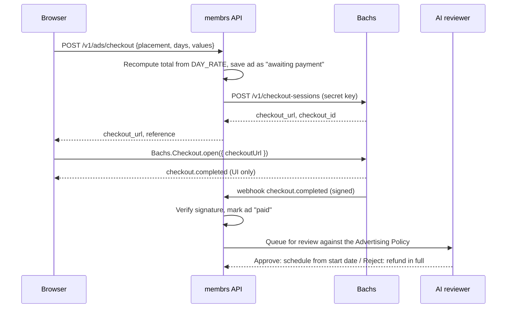

# Ad payments with Bachs

Advertisers pay for the whole run before their ad is reviewed. Bachs
(https://docs.bachs.io) takes the payment; membrs never sees card details.

## Flow



The browser event only moves the screen on to "Paid. Your ad is in review."
The ad is fulfilled from the signed webhook, never from the browser.

## Server endpoint

`POST /v1/ads/checkout` is the one endpoint the frontend calls. It must:

1. Validate the fields and that `placement` is one of the day-rate keys.
2. Recompute the total with the same table as `src/lib/ads.ts`. Never trust
   a total sent by the browser.
3. Save the ad with status `awaiting_payment` and a reference like `AD-7KQ2XM`.
4. Create the Bachs session and return `{ checkout_url, reference }`.

```ts
// Node, with the secret key from the environment. Sandbox first.
const BACHS = process.env.BACHS_API_BASE ?? 'https://sandbox-api.bachs.io';

const res = await fetch(`${BACHS}/v1/checkout-sessions`, {
  method: 'POST',
  headers: {
    authorization: `Bearer ${process.env.BACHS_SECRET_KEY}`, // sk_sandbox_ or sk_live_
    'content-type': 'application/json',
  },
  body: JSON.stringify({
    pricing: { currency: 'NGN', amount: total.toFixed(2) },
    metadata: { reference, kind: 'ad' },
  }),
});
const { checkout_url, checkout_id } = await res.json();
```

Store `checkout_id` against the ad so the webhook can find it.

## Webhook

Handle `checkout.completed` (or `collection.succeeded`):

1. Verify the signature with the webhook secret from the Bachs dashboard.
   Reject anything that fails.
2. Look the ad up by `checkout_id` or `metadata.reference`. Ignore repeats:
   webhooks can arrive more than once.
3. Mark it `paid` and queue it for the reviewer.

The reviewer checks the banner, copy and link against the Advertising Policy.
Anything not safe for work is rejected. Rejected ads are refunded in full
through Bachs and the advertiser gets an email with the reason.

## Frontend settings

| Variable        | Effect                                                                                          |
| --------------- | ----------------------------------------------------------------------------------------------- |
| `VITE_API_BASE` | Set: real checkout through the API. Empty: a plain "Test checkout" dialog that charges nothing. |

The Bachs script (`https://checkout.bachs.io/bachs.js`) loads on first focus
inside the ad form, not on page load. If a Content Security Policy is added,
allow `checkout.bachs.io` for scripts and frames.
